

<picture><source media="(prefers-color-scheme: dark)" srcset="assets/hero-dark.svg"></picture>

<picture><source media="(prefers-color-scheme: dark)" srcset="assets/social-l-dark.svg"></picture><a href="https://t.me/tovarCuHuX"><picture><source media="(prefers-color-scheme: dark)" srcset="assets/social-1-dark.svg"></picture></a><a href="https://tiktok.com/@kot_lvovich"><picture><source media="(prefers-color-scheme: dark)" srcset="assets/social-2-dark.svg"></picture></a><a href="https://vk.ru/arkich3"><picture><source media="(prefers-color-scheme: dark)" srcset="assets/social-3-dark.svg"></picture></a><a href="https://youtube.com/@izmoeyzishni"><picture><source media="(prefers-color-scheme: dark)" srcset="assets/social-4-dark.svg"></picture></a><picture><source media="(prefers-color-scheme: dark)" srcset="assets/social-r-dark.svg"></picture>

<picture><source media="(prefers-color-scheme: dark)" srcset="assets/about-dark.svg"></picture>

<picture><source media="(prefers-color-scheme: dark)" srcset="assets/stack-dark.svg"></picture>

<a href="https://github.com/maksemkich46/App"><picture><source media="(prefers-color-scheme: dark)" srcset="assets/project-app-dark.svg"></picture></a>&nbsp;<a href="https://github.com/maksemkich46/rasp_solntstrans.github.io"><picture><source media="(prefers-color-scheme: dark)" srcset="assets/project-rasp-solntstrans-github-io-dark.svg"></picture></a>

<a href="https://github.com/maksemkich46/Fontonica"><picture><source media="(prefers-color-scheme: dark)" srcset="assets/project-fontonica-dark.svg"></picture></a>&nbsp;<a href="https://github.com/maksemkich46/AppFtca"><picture><source media="(prefers-color-scheme: dark)" srcset="assets/project-appftca-dark.svg"></picture></a>

<a href="https://github.com/maksemkich46/Obo_mne"><picture><source media="(prefers-color-scheme: dark)" srcset="assets/project-obo-mne-dark.svg"></picture></a>

<picture><source media="(prefers-color-scheme: dark)" srcset="assets/stats-dark.svg"></picture>

<picture><source media="(prefers-color-scheme: dark)" srcset="assets/streak-dark.svg"></picture>

<picture><source media="(prefers-color-scheme: dark)" srcset="assets/wave-dark.svg"></picture>

<picture><source media="(prefers-color-scheme: dark)" srcset="assets/button-l-dark.svg"></picture><a href="https://github.com/maksemkich46?tab=repositories"><picture><source media="(prefers-color-scheme: dark)" srcset="assets/button-1-dark.svg"></picture></a><picture><source media="(prefers-color-scheme: dark)" srcset="assets/button-r-dark.svg"></picture>

<a href="https://metawka.github.io/expressive-profile/?from=maksemkich46"><picture><source media="(prefers-color-scheme: dark)" srcset="assets/credit-dark.svg"></picture></a>

